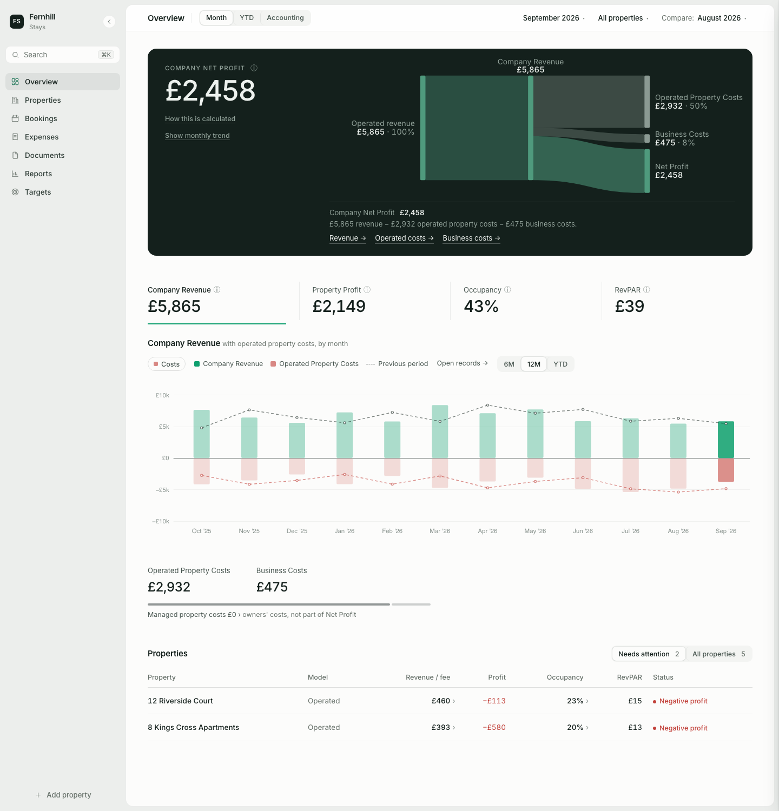
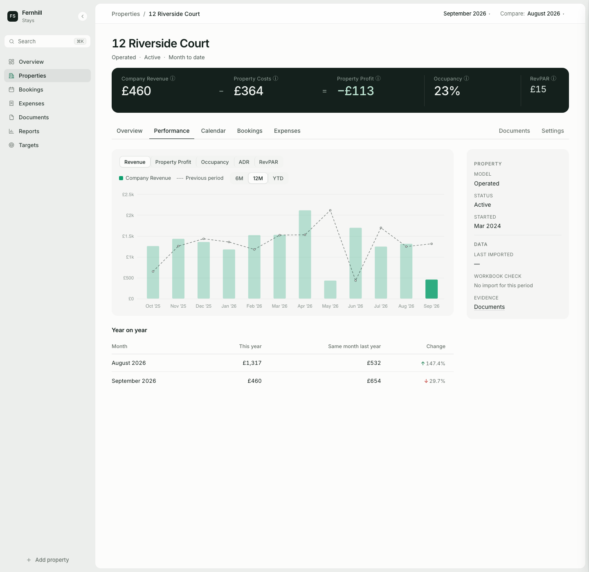
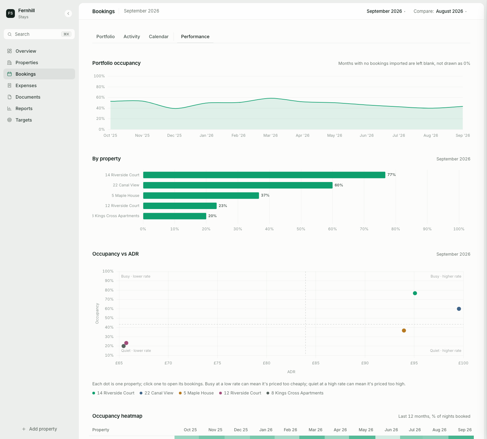
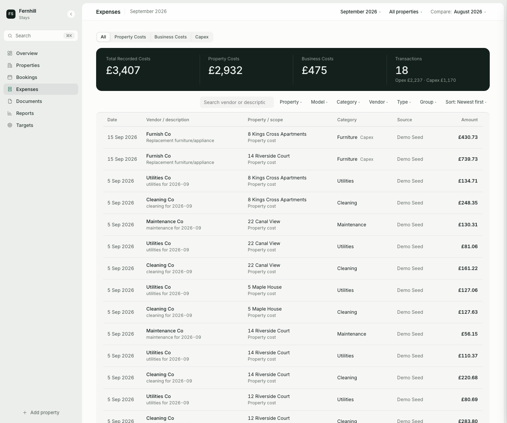
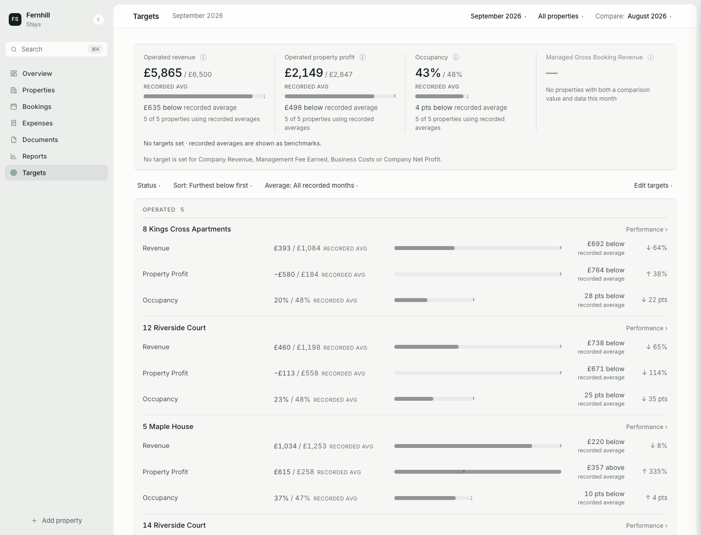
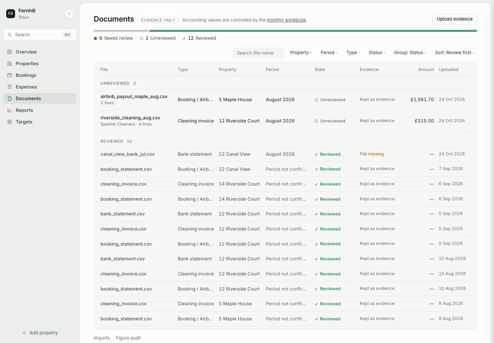
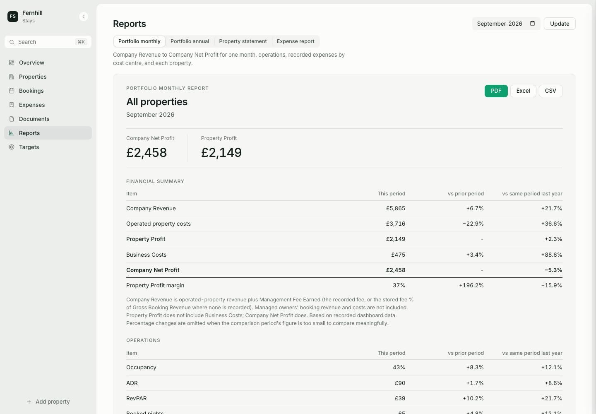

# Property Analytics Dashboard

An operations and analytics system for a short-term-rental portfolio: bookings, expenses, documents, targets and reporting in one Flask application.

I built it to replace a spreadsheet-based monthly reporting process for a real serviced-accommodation business, and it is in daily use there. This repository is a **public, sanitised version**: the code and features are the same, but all data is synthetic, the business is renamed to a fictional one (*Fernhill Stays*), and production deployment, server configuration and backup tooling have been removed.



## Features

- **Portfolio overview:** company revenue, property profit, net profit, occupancy, ADR and RevPAR, with month / YTD / accounting-year views and period comparison. A flow chart shows how revenue becomes profit.
- **Operated vs managed properties:** an operated flat's bookings count as company revenue; a managed flat's bookings belong to its owner and only the management fee counts. KPIs, reports and targets all respect the distinction.
- **Property workspaces:** performance, booking calendar, bookings, expenses, documents and settings for each property.
- **Booking analytics:** portfolio calendar, occupancy and performance by property and month, iCal calendar sync.
- **Expense tracking:** operating vs capital costs, vendor and category grouping, shared business overheads, a transaction ledger with edit history.
- **Document workflow:** upload → extract → review → confirm. CSV and Excel files are parsed directly; PDFs and images can optionally be extracted with the Anthropic API. Nothing reaches the ledger without review, and a confirmed import can be undone.
- **Monthly workbook import:** reads a structured Excel accounts workbook, shows a preview with row-level differences, applies it as a batch, and can undo it. A reconciliation view handles months where workbook totals and detailed bookings overlap.
- **Targets:** revenue, profit and occupancy targets per property, with recorded averages shown where no target is set.
- **Data completeness:** shows which property-months are missing data instead of treating gaps as zero.
- **Reports:** monthly, annual and expense reports as PDF, Excel and CSV.

| Property workspace | Bookings performance |
|---|---|
|  |  |
| **Expenses** | **Targets** |
|  |  |
| **Documents** | **Reports** |
|  |  |

## Architecture

**Stack:** Python 3, Flask, Jinja2, SQLite, Chart.js, HTMX, Alpine.js, openpyxl, ReportLab, optional Anthropic API. Runs under gunicorn in production.

```text
dashboard/
  app.py            app factory: security headers, error pages, proxy handling, cookies
  db.py             SQLite schema and access (WAL mode and busy timeout when hosted)
  routes/           one blueprint per area: overview, properties, bookings, expenses,
                    documents, imports, reconciliation, targets, reports, auth
  services/
    kpis.py         single metric layer: revenue, costs, profit, occupancy, ADR, RevPAR
    extraction.py   document parsing (CSV/XLSX) and optional AI extraction (PDF/images)
    ingest.py       turns reviewed documents into bookings and transactions
    workbook/       Excel workbook reader, import plan, apply/undo, configuration
    reconcile.py    workbook totals vs detailed bookings
    reporting.py    PDF / Excel / CSV report builders
    netsafe.py      safe outbound fetching for calendar URLs
  templates/, static/
scripts/
  seed_demo_data.py synthetic demo database
  manage_users.py   create and manage sign-in accounts
tests/              regression suites, each against its own scratch database
```

Design choices:

- **Normalised records, derived KPIs.** Bookings, transactions and documents are stored once; every figure is computed on read through `services/kpis.py`, so the overview, property pages, targets and reports always agree.
- **Missing is not zero.** Months without data are shown as missing, not as 0% occupancy or £0 revenue.
- **Traceability.** Financial records keep their source (document, workbook cell or manual entry), and edits are written to an audit log.

## Running locally

```bash
git clone https://github.com/DadoCode/property-analytics-dashboard.git
cd property-analytics-dashboard
python3 -m venv .venv && source .venv/bin/activate
pip install -r requirements.txt

# build a synthetic database: five fictional flats, a year of bookings and costs, sample documents
export DASHBOARD_DB_PATH=/tmp/pad-demo/dashboard.db DASHBOARD_UPLOADS_PATH=/tmp/pad-demo/uploads
mkdir -p /tmp/pad-demo
python scripts/seed_demo_data.py

flask --app dashboard/app run --port 5051
```

Open <http://127.0.0.1:5051/>. The seed script deletes and rebuilds the database it is pointed at, so it refuses to run unless `DASHBOARD_DB_PATH` is set.

Optional: copy `.env.example` to `.env` and set `ANTHROPIC_API_KEY` to enable AI extraction for PDF and image documents.

## Tests

```bash
for t in tests/test_*.py; do python "$t" || echo "FAILED: $t"; done
```

22 test suites cover the KPI calculations (including operated vs managed properties and loss-making months), the overview chart for every metric, the document, import, reconciliation, targets and reports workflows, and the security hardening below. Each suite builds its own throw-away database.

## Security

Production mode is covered by `tests/test_hosted_security.py`:

- Per-user accounts with scrypt password hashes, owner/viewer roles and a sign-in throttle; no public sign-up
- HTTPS-only `__Host-` session cookie, HSTS, Content-Security-Policy and other security headers; same-origin check on every write
- Upload allowlist with content checks; stored paths are relative and path traversal is refused
- Calendar links are fetched only over HTTPS from public addresses, with every redirect re-checked (no private-network or metadata targets)
- Error pages never reveal internals; the database, uploads and source files are never served

## About this repository

- All properties, bookings, amounts, vendors and documents are generated by `scripts/seed_demo_data.py` or invented for tests.
- The production database, uploaded documents, real property configuration, credentials, hosting and backup procedures are not included and are maintained privately.
- I defined the requirements, data model, business rules (such as operated vs managed accounting), testing approach and interface, and used AI coding tools, mainly Claude Code, to speed up implementation.

## Licence

[MIT](LICENSE)
